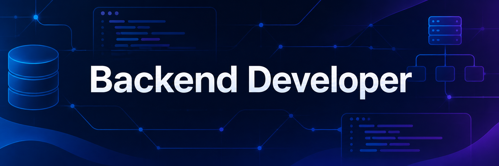

  

  <h1>
    
    Welcome to my portfolio
    
  </h1>

  <h3>My name is Denis Navío</h3>

  

    Second-year <b>Multiplatform Application Development (DAM)</b> student 💻 
    Passionate about <b>backend development</b> ⚙️ 
    Currently doing an internship at <a href="https://timematters.ai" target="_blank"><b>Time Matters</b></a> 🚀
  

 

## About me

  I enjoy understanding how applications work behind the scenes and turning ideas into useful solutions.
  My current goal is to learn about different areas of backend development and build a strong foundation through hands-on programming, so I can work in this field in the future and become a good programmer.

  

## Contact

  <a href="mailto:denisnavio12@gmail.com">
    
    Denisnavio12@gmail.com
  </a> 
  <a href="https://github.com/denisnavioo">
    
    denisnavioo
  </a> 
  <a href="https://www.linkedin.com/in/denis-navio-26a50a306/">
    
    Denis Navío
  </a>

 

<h2>
  
  Tech Stack
</h2>

### Languages

  
  
  
  
  

### Frameworks & Libraries

  
  
  
  
  

### Databases

  
  

### Tools & Environment

  
  
  
  
  
  
  
  
  
  
  

 

<h2>Current Projects 🚀</h2>

<table>
  <tr>
    <td width="480">
      <a href="https://gitlab.com/grup47650143/projecte1" target="_blank"><b>Project 1 — Car Rental Platform</b></a>  
         
        
      
        A collaborative web application developed as a team project in the second year of DAM to manage a car rental business. Built with a <b>Java</b> backend and <b>HTML</b> and <b>CSS</b> views, it lets users manage the fleet, bookings, customers, and vehicle availability using a Git-based workflow.
        
      
      
      
      
    </td>
  </tr>
</table>

 

<h2>In Progress... 🛠️</h2>

<table>
  <tr>
    <td width="480">
      <b>Web Duo — Development &amp; Self-Hosted</b>  
         
        
      
        A private shared planner that helps two people organize their calendars, weekly schedules, shared plans, savings, and expenses in one place. It also includes daily notes and updates, while keeping personal financial information visible only to its owner.
        
      
      
      
      
    </td>
  </tr>
</table>

 

<!--
**denisnavioo/denisnavioo** is a ✨ _special_ ✨ repository because its `README.md` (this file) appears on your GitHub profile.

Here are some ideas to get you started:

- 🔭 I’m currently working on ...
- 🌱 I’m currently learning ...
- 👯 I’m looking to collaborate on ...
- 🤔 I’m looking for help with ...
- 💬 Ask me about ...
- 📫 How to reach me: ...
- 😄 Pronouns: ...
- ⚡ Fun fact: ...
-->
<!--
**denisnavioo/denisnavioo** is a ✨ _special_ ✨ repository because its `README.md` (this file) appears on your GitHub profile.

Here are some ideas to get you started:

- 🔭 I’m currently working on ...
- 🌱 I’m currently learning ...
- 👯 I’m looking to collaborate on ...
- 🤔 I’m looking for help with ...
- 💬 Ask me about ...
- 📫 How to reach me: ...
- 😄 Pronouns: ...
- ⚡ Fun fact: ...
-->
